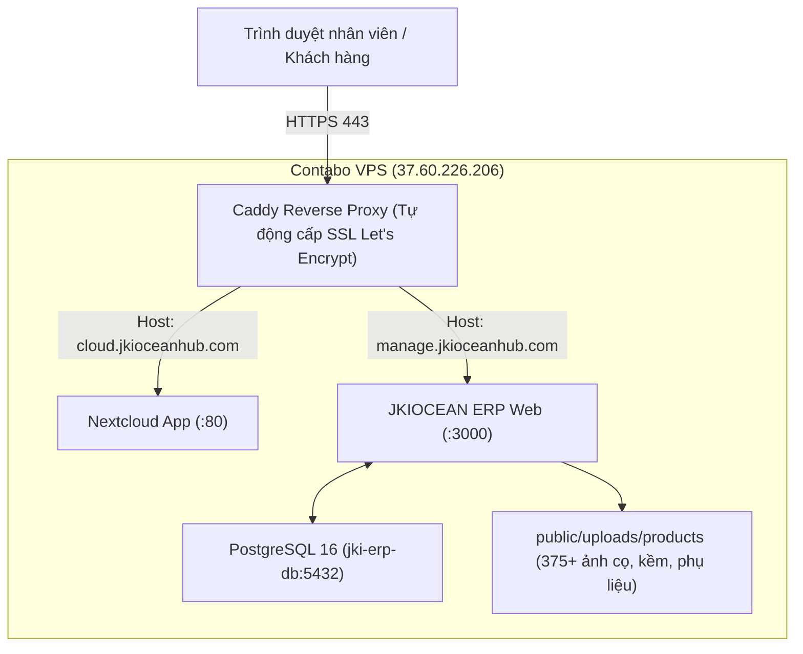

# Hướng Dẫn Triển Khai JKIOCEAN Management Hub Lên VPS Contabo Công Ty

* **Ứng dụng**: JKIOCEAN Management Hub (Quản lý Kho, Khách hàng B2B, Xuất Báo Giá Kèm Ảnh, Công Nợ AR)
* **Máy chủ VPS**: Contabo Cloud VPS 6 (`vmi3636449`)
* **IP Server**: `37.60.226.206` (Ubuntu 24.04 LTS)
* **Tên miền truy cập (Subdomain)**: `https://manage.jkioceanhub.com`
* **Hệ sinh thái liên kết trên VPS**: Nextcloud Hub (`https://cloud.jkioceanhub.com`), Rclone Google Drive 5TB, Coturn Talk.

---

## 1. Kiến Trúc Mạng Trên VPS



---

## 2. Các Bước Triển Khai Chi Tiết Lên VPS

### Bước 1: Trỏ Bản Ghi DNS Tên Miền
Truy cập trang quản lý DNS (Cloudflare / Namecheap / GoDaddy) của tên miền `jkioceanhub.com`:
* Thêm bản ghi **A record**:
  * **Type**: `A`
  * **Name**: `manage` (hoặc `manage.jkioceanhub.com`)
  * **IPv4 Address**: `37.60.226.206`
  * **TTL**: Auto / 5 minutes
  * **Proxy status**: DNS Only (nếu dùng Caddy tự cấp chứng chỉ SSL)

### Bước 2: Cập Nhật Caddyfile Trên VPS
Trên VPS (`/opt/nextcloud/Caddyfile` hoặc file cấu hình Caddy đang chạy):
Thêm khối cấu hình sau vào Caddy:

```caddyfile
manage.jkioceanhub.com {
    encode gzip zstd

    # Bảo mật tiêu chuẩn
    header {
        Strict-Transport-Security "max-age=31536000; includeSubDomains; preload"
        X-Content-Type-Options "nosniff"
        X-Frame-Options "SAMEORIGIN"
    }

    # Reverse proxy sang ứng dụng Management Hub
    reverse_proxy jki-erp-web:3000 {
        header_up Host {host}
        header_up X-Real-IP {remote}
        header_up X-Forwarded-For {remote}
        header_up X-Forwarded-Proto https
    }
}
```

Sau đó reload Caddy:
```bash
docker exec -it nextcloud-caddy-1 caddy reload --config /etc/caddy/Caddyfile
```

### Bước 3: Đẩy Mã Nguồn & Thư Mục Ảnh Sản Phẩm Lên VPS
Từ máy tính cá nhân (PowerShell hoặc Terminal):
```bash
# Nén hoặc rsync mã nguồn lên thư mục /opt/jki-erp trên VPS
ssh root@37.60.226.206 "mkdir -p /opt/jki-erp"

# Đẩy toàn bộ source code (bao gồm data/ và public/uploads/products) lên VPS
scp -r * root@37.60.226.206:/opt/jki-erp/
```

### Bước 4: Khởi Chạy Bằng Docker Compose
SSH vào VPS:
```bash
ssh root@37.60.226.206
cd /opt/jki-erp

# Đảm bảo file .env đã cấu hình đúng
cp .env.example .env

# Đảm bảo mạng docker kết nối với Caddy (mạng 'nextcloud_net' hoặc 'coolify')
docker network inspect nextcloud_net >/dev/null 2>&1 || docker network create nextcloud_net

# Khởi chạy cụm container
docker compose up -d --build
```

### Bước 5: Đẩy Dữ Liệu Sản Phẩm & Khách Hàng (Prisma Seed)
Chạy lệnh nạp tự động toàn bộ 345+ sản phẩm kèm ảnh và 32 khách hàng thực tế vào Database PostgreSQL:
```bash
docker exec -it jki-erp-web npx prisma db push
docker exec -it jki-erp-web npx prisma db seed
```

### Bước 6: Kiểm Tra Truy Cập
Mở trình duyệt: [https://manage.jkioceanhub.com](https://manage.jkioceanhub.com)
1. Danh mục 345+ sản phẩm (Z Brushes, Kềm cắt da, Gel, Bột Ombre, Phụ liệu) hiển thị đầy đủ hình ảnh và giá sỉ/lẻ.
2. 32 khách hàng thực tế kèm lịch sử hóa đơn, ngày đi hàng và công nợ.
3. Tạo báo giá siêu tốc: Chọn sản phẩm -> nhập số lượng -> 1 click Copy Text gửi Zalo/SMS hoặc In/Lưu PDF trực tiếp.
